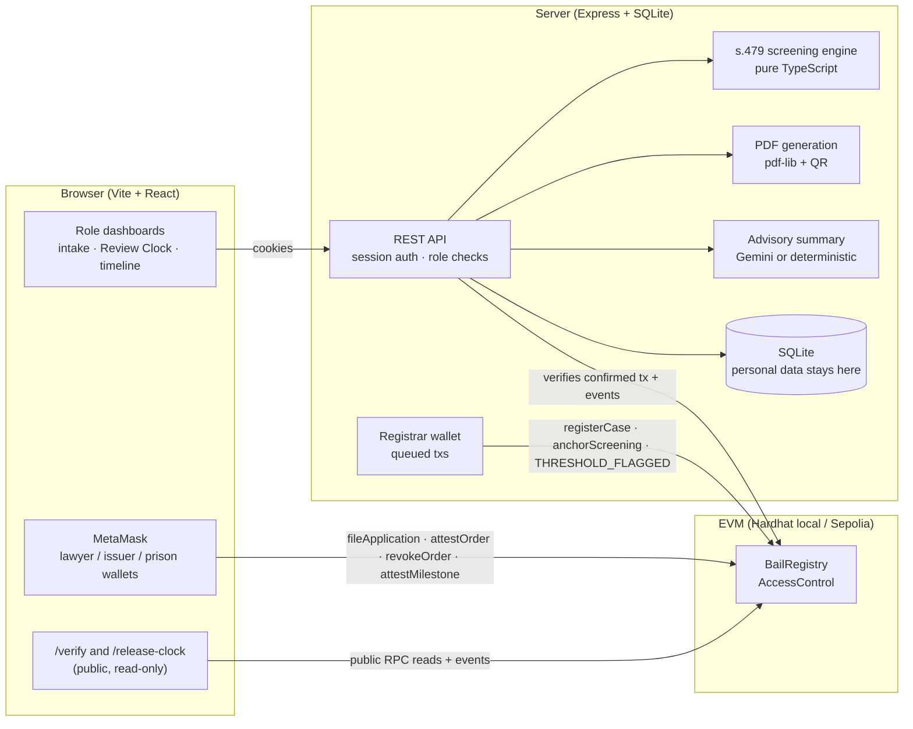

# BailBridge

**From Detention Threshold to Verified Release.**

BailBridge is a legal-aid coordination and audit prototype for undertrial cases in India. It flags cases that need **Section 479 BNSS** review, tracks whether each party has done its part — including the jail superintendent's statutory duty under s.479(3) — and makes bail documents independently verifiable.

It is **not** a court system and **never decides bail**. Every screening result is a prompt for legal review.

> **Prototype · synthetic data only.** All people, cases and institutions are fictional. Institutional identities are labelled "Demo". No integrations, deployments, partnerships or impact are claimed beyond what is described here.

Built for the BLI Legal Tech Hackathon 2 (DoraHacks, Ethereum/EVM track).

---

## Contents

- [The problem](#the-problem)
- [Who it is for](#who-it-is-for)
- [What it does](#what-it-does)
- [Why a blockchain](#why-a-blockchain)
- [Architecture](#architecture)
- [Legal rules implemented](#legal-rules-implemented)
- [Smart contract](#smart-contract-bailregistry)
- [Privacy and trust model](#privacy-and-trust-model)
- [Relationship to FASTER and official systems](#relationship-to-faster-and-official-systems)
- [Setup](#setup)
- [Environment variables](#environment-variables)
- [Demo accounts and wallet setup](#demo-accounts-and-wallet-setup)
- [Deploying to Sepolia](#deploying-to-sepolia)
- [Off-chain mode](#off-chain-mode)
- [Tests and build results](#tests-and-build-results)
- [3-minute demo script](#3-minute-demo-script)
- [Scope and limitations](#scope-and-limitations)
- [Roadmap](#roadmap)
- [Project structure](#project-structure)

---

## The problem

Most people held in Indian prisons have not been convicted. According to the National Crime Records Bureau's *Prison Statistics India 2022*, undertrial prisoners numbered **4,34,302 of 5,73,220** prisoners — about **75.8%** of the prison population ([NCRB](https://www.ncrb.gov.in/)). *(Figures as published for 2022; verify against the NCRB report before reuse.)*

Section 479 of the Bharatiya Nagarik Suraksha Sanhita, 2023 (BNSS) — formerly s.436A CrPC — provides for the release on bail of an undertrial who has been detained for one-half of the maximum sentence for the offence (one-third for a first-time offender), and **requires the jail superintendent to apply to the court in writing** once that point is reached.

The people who make this work — legal-aid lawyers, NGO caseworkers, prisons and courts — keep separate records and do not fully trust each other's. In practice it is hard to know:

1. which cases have crossed the threshold, and by how long;
2. whether the superintendent's application, the lawyer's filing and the court's order have actually happened; and
3. whether a bail order in someone's hand is genuine, current and unaltered.

## Who it is for

The primary user is a **legal-aid lawyer or NGO caseworker** handling many undertrial cases. Prison superintendents and court registries (represented here by Demo identities) record their own steps.

## What it does

| Feature | What works |
| --- | --- |
| **Case intake + Review Clock** (`/cases/new`, `/cases/:id`) | Intake with interrupted custody periods, excluded days, conviction history, other pending cases. Live screening preview. Progress bar "X / Y qualifying days", status badge, reasons, missing information, full calculation. Advisory summary (Gemini if configured; deterministic otherwise) that explains facts and never recommends a decision. On save, a salted commitment to the record and to the screening snapshot is anchored on-chain. |
| **Release Tracker** (`/dashboard`, case timeline) | Six milestones, each an on-chain attestation by a specific role: threshold flagged (registrar) → superintendent s.479(3) application (prison) → application filed (lawyer) → order attested (Demo issuer) → order received (prison) → release acknowledged (prison). Superintendent application and filing can happen in either order. Duplicates, wrong roles and acknowledgement against a revoked order are rejected by the contract. Dashboard groups cases by who must act next, led by **"Threshold reached, superintendent application not recorded (N days)"**. Day badges are workflow delay, not statutory deadlines. |
| **Verifiable documents** | Lawyer generates a clearly marked **DRAFT** s.479 application PDF → browser computes keccak256 of the exact bytes → lawyer signs `fileApplication` in MetaMask → uploads the same bytes → server recomputes the hash, reads the confirmed tx and checks case linkage and wallet. Issuer attests orders with **two separate hashes**: `structuredOrderHash` (canonical JSON) and `pdfHash` (final PDF bytes, rendered with a QR to `/verify?order=<id>` *before* hashing). Issuer can revoke with a reason commitment. |
| **Public `/verify`** | Drop a PDF (hashed in the browser, never uploaded) or open a QR link. Shows separately: file matches registered bytes · attested by authorised Demo issuer · ACTIVE / REVOKED, plus milestone receipts. QR alone says "Record found — drop the PDF to verify the file". Distinguishes "Not registered" from "RPC unavailable". An altered PDF fails. |
| **Public `/release-clock`** | Anonymised aggregate from contract events since the deployment block: cases tracked, thresholds flagged, superintendent applications, applications filed, orders attested, releases acknowledged, plus a table of random case IDs with current milestone and elapsed days. No names, FIRs, offences or custody data. |
| **Seed + off-chain mode** | One command seeds five demo cases (plus a revoked order) with DB and chain in agreement. Without chain configuration, intake, screening, timeline and PDFs still work and wallet actions are disabled. |

**P1 — supersede:** the issuer can replace an ACTIVE order with a corrected one. The old order stays on the log as SUPERSEDED with an append-only link old → new (reason kept off-chain, commitment on-chain); the prison must acknowledge the new order before release, and `/verify` shows the link in both directions.

## Why a blockchain

Lawyers, NGOs, prisons and courts do not share a database and do not fully trust each other. A shared, append-only log that none of them can quietly edit lets each party prove **who did what, and when** — without handing personal data to the others or to the public:

- each step is signed by a wallet holding a specific role, so a missing superintendent application is visible, not deniable;
- document hashes let anyone check that an order is the registered one and still active, without contacting the issuer;
- commitments let a party later prove its off-chain record has not changed since it was anchored.

## Architecture



Flow of a wallet action: **server prepares** (hashes / commitments) → **user signs** in MetaMask (after pre-flight checks for network, account, role, balance and a simulated call) → **server confirms** by reading the receipt: tx succeeded, was sent to the registry, was signed by the user's mapped wallet, emitted the expected event with matching fields, and has not been recorded before.

## Legal rules implemented

Source: **Bharatiya Nagarik Suraksha Sanhita, 2023 (Act 46 of 2023), s.479**; offence punishments from the **Bharatiya Nyaya Sanhita, 2023 (Act 45 of 2023)**, [India Code](https://www.indiacode.nic.in/handle/123456789/20062). IPC sections map to BNS; BNSS is the procedure code.

| Rule | Implementation |
| --- | --- |
| s.479(1): release after detention up to **one-half** of the maximum imprisonment | `threshold = ceil(maxSentenceDays / 2)` |
| Proviso: **first-time offender** (never convicted of *any* offence — not "first arrest") at **one-third** | `ceil(maxSentenceDays / 3)` only when previous conviction = "no" |
| Unknown conviction history | Computed at one-half; flagged "first-time status unverified"; one-third figure shown for reference |
| Not applicable to offences punishable with **death or life imprisonment** | `OUTSIDE_SCREENING_RULE` |
| s.479(2): investigation, inquiry or trial pending in **more than one offence or multiple cases** | `SPECIALIST_REVIEW_REQUIRED` — no "gravest offence wins" shortcut. Unknown → `INSUFFICIENT_INFORMATION` |
| Detention attributable to **delay caused by the accused** is excluded | Excluded days subtracted; cannot exceed counted custody |
| s.479(3): superintendent must **forthwith apply in writing** to the court | The Release Tracker's `SUPERINTENDENT_APPLICATION` milestone and the dashboard's lead queue |

**Outputs** — exactly one of `APPROACHING_THRESHOLD`, `THRESHOLD_REACHED_REVIEW_REQUIRED`, `SPECIALIST_REVIEW_REQUIRED`, `OUTSIDE_SCREENING_RULE`, `INSUFFICIENT_INFORMATION`, plus counted / excluded / qualifying days, threshold days, fraction, estimated threshold date, reason codes, missing information, rule version (`BNSS-479-v1`) and legal source. The UI says *"Threshold reached N days ago — s.479(3) application and legal review required"* and never uses "must be released", "automatic bail" or "unlawfully detained" (enforced by tests and by a filter on AI output).

**Prototype conventions that need legal validation:** maximum term = years × 365, months × 30; custody days counted inclusively (first and last day both count); custody periods may be interrupted but may not overlap or lie in the future.

**Offence data** — [`server/data/offences.csv`](server/data/offences.csv) holds 20 reviewed variants (theft first/repeat conviction, theft in dwelling, robbery and its highway-at-night limb, hurt, grievous hurt, criminal breach of trust, cheating, criminal trespass, house-trespass, criminal intimidation, plus death/life offences and a fine-only offence). Columns: `id, act, section, subsection, offence, punishmentText, maxSentenceDays, capitalOrLife, fineOnly, mappedAct, mappedSection, sourceUrl, notes`. Where a maximum cannot be modelled reliably (e.g. quantity-dependent NDPS offences) the row is marked unsupported rather than guessed. Punishments were checked against the BNS text; the dataset still needs review by a practising lawyer.

## Smart contract: `BailRegistry`

[`contracts/contracts/BailRegistry.sol`](contracts/contracts/BailRegistry.sol) — Solidity 0.8.24, OpenZeppelin v5 `AccessControl`.

| Function | Role | Notes |
| --- | --- | --- |
| `registerCase(caseId, recordCommitment)` | REGISTRAR | `caseId` is a random bytes32 |
| `anchorScreening(caseId, screeningCommitment, ruleVersion)` | REGISTRAR | re-anchoring allowed; every anchor emits an event |
| `fileApplication(caseId, pdfHash) → appId` | LAWYER | also records `APPLICATION_FILED` |
| `attestOrder(caseId, appId, orderId, structuredOrderHash, pdfHash)` | ISSUER | application must belong to the case; one order per application; the two hashes must differ and are registered as different document kinds |
| `revokeOrder(orderId, reasonCommitment)` | ISSUER | ACTIVE → REVOKED; history kept |
| `supersedeOrder(old, new, structuredOrderHash, pdfHash, reasonCommitment)` | ISSUER | P1: ACTIVE → SUPERSEDED with link old → new; the new order needs its own prison receipt |
| `attestMilestone(caseId, orderId, milestone, evidenceCommitment)` | per milestone | `THRESHOLD_FLAGGED` registrar; `SUPERINTENDENT_APPLICATION`, `ORDER_RECEIVED_BY_PRISON`, `RELEASE_ACKNOWLEDGED` prison. Receipt and release require an ACTIVE order of the same case; release requires recorded receipt |
| `verifyDocument(hash) → (kind, id)`, `getCase`, `getApplication`, `getOrder`, `getMilestones` | public | |

Custom errors for every failure, events on every state change, duplicate prevention for cases, documents and once-only milestones.

## Privacy and trust model

**Nothing personal or plaintext-legal goes on-chain.** The chain holds only random IDs, hashes, commitments, role-holder addresses and timestamps.

- **Commitment** = `keccak256("bailbridge:" + kind + ":" + serverSecret + ":" + perRecordSalt + ":" + canonicalJSON({v, kind, data}))`. The server secret stops anyone brute-forcing low-entropy records (names, dates) from the on-chain value; the per-record salt makes identical records produce different commitments; the version keeps the format unambiguous.
- **Commitments prove consistency, not truth.** A commitment shows that an off-chain record is the same one that was anchored at a given time. It does **not** show that the custody dates, conviction history or anything else in it are correct.
- **Document hashes** prove that a PDF's exact bytes were registered by a given role-holder. PDF hashes are only ever compared with registered PDF hashes, never with structured-JSON hashes. No PDF contains its own hash.
- **Trusted actors remain:** the people who enter facts; the admin who grants roles (wallet keys stand in for institutional identity — the server checks that each demo account signs with its mapped wallet, but there is no signed-challenge wallet binding yet); the lawyer who must review the calculation; and the court, whose real order this prototype does not replace.
- The advisory summary sends only screening facts to Gemini — no names, case references or court names.
- `/verify` hashes files locally; they are never uploaded. `/release-clock` shows only random case IDs, milestones and timestamps.

## Relationship to FASTER and official systems

The Supreme Court of India's **FASTER** system (Fast and Secured Transmission of Electronic Records) transmits authenticated court orders, including bail orders, electronically to prisons and other authorities. Official platforms such as e-Courts and ICJS also exist.

BailBridge is **not** a replacement for, or an integration with, any of these. It is a complementary prototype coordination and audit layer for legal-aid workers: it focuses on spotting s.479 cases, making each party's step (especially the superintendent's s.479(3) application) visible, and letting anyone check a document's integrity. Any real deployment would need to work alongside official systems.

---

## Setup

### Prerequisites

- **Node.js 20.19+ or 22.12+** (Vite 7 requirement; developed on Node 24) and npm 10+
- **MetaMask** (or another EIP-1193 browser wallet) for role actions
- Git

### 1. Install

```bash
git clone <repo-url> bailbridge && cd bailbridge
cp .env.example .env          # optional for local; required for Sepolia
npm install
```

npm 11 may warn that `better-sqlite3`, `esbuild`, `keccak` and `secp256k1` have install scripts not covered by `allowScripts`. If the server later fails to load SQLite, run `npm approve-scripts better-sqlite3 esbuild` and `npm install` again.

### 2. Local chain + contracts (terminal 1 and 2)

```bash
npm run chain                 # terminal 1: Hardhat node on http://127.0.0.1:8545 (chainId 31337)
npm run deploy:local          # terminal 2: deploys BailRegistry, grants roles, exports deployment + ABI
```

`deploy:local` writes `deployments/localhost.json`, `server/src/generated/deployment.json` and `web/src/generated/deployment.json`. A Hardhat node is ephemeral: **after restarting it, re-run `deploy:local` and the seed.**

### 3. Seed the demo (server stopped)

```bash
npm run seed -- --reset       # resets the local DB, seeds 5 demo cases + a revoked order on-chain
```

It prints the hero-case link, `/verify` links for the active and revoked orders, and writes `server/storage/<network>/demo-files/` containing the original order PDF, a **one-byte-modified copy**, and the revoked order PDF for the verify demo.

### 4. Run (terminal 2 and 3)

```bash
npm run server:dev            # API on http://localhost:4000
npm run web:dev               # web on http://localhost:5173 (proxies /api to :4000)
```

Open http://localhost:5173.

### Single-origin production build

`npm run build` compiles contracts, server and web. `npm run start -w server` serves the API **and** the built web app from `web/dist` on one port; set `PUBLIC_WEB_URL` to that origin and `COOKIE_SECURE=true` behind HTTPS.

## Environment variables

See [`.env.example`](.env.example). One `.env` serves both setups: on a local Hardhat chain (chainId 31337) the deploy script, server and seed **ignore** the Sepolia role, RPC and key values and always use the well-known Hardhat accounts. Highlights:

| Variable | Used by | Purpose |
| --- | --- | --- |
| `COMMITMENT_SECRET` | server | Secret mixed into every commitment. **Required in production**; keep stable. |
| `DEMO_PASSWORD` | server | Password for all demo accounts (default `bailbridge-demo`). |
| `PUBLIC_WEB_URL` | server | Origin printed in order-PDF QR codes (default `http://localhost:5173`). |
| `RPC_URL`, `REGISTRAR_PRIVATE_KEY` | server | Chain mode. Default automatically on a local Hardhat chain; required on Sepolia. |
| `DEMO_LAWYER_WALLET`, `DEMO_ISSUER_WALLET`, `DEMO_PRISON_WALLET` | server | Wallets mapped to demo users (default: deployment roles / Hardhat #1–#3). |
| `CHAIN_DISABLED` | server | `true` forces off-chain mode. |
| `GEMINI_API_KEY`, `GEMINI_MODEL` | server | Optional AI summary (default model `gemini-2.5-flash`). |
| `SEPOLIA_RPC_URL`, `DEPLOYER_PRIVATE_KEY` | contracts | Sepolia deployment. |
| `ADMIN_ADDRESS`, `REGISTRAR_ADDRESS`, `LAWYER_ADDRESSES`, `ISSUER_ADDRESSES`, `PRISON_ADDRESSES` | contracts | Role grants at deploy time. |
| `PUBLIC_RPC_URL`, `EXPLORER_URL` | contracts | Exported for the browser's read-only RPC and explorer links. |
| `SEED_LAWYER_PRIVATE_KEY`, `SEED_ISSUER_PRIVATE_KEY`, `SEED_PRISON_PRIVATE_KEY` | seed | Role wallets for seeding on Sepolia. |

Private keys are read from `.env` only and are never printed or committed.

## Demo accounts and wallet setup

| Username | Role | Wallet (local default) |
| --- | --- | --- |
| `caseworker` | Demo NGO caseworker — intake and screening | — |
| `lawyer` | Demo legal-aid lawyer — draft and file applications | Hardhat #1 `0x7099…79C8` |
| `issuer` | Demo court issuer — attest and revoke orders | Hardhat #2 `0x3C44…93BC` |
| `prison` | Demo district prison superintendent — s.479(3), receipt, release | Hardhat #3 `0x90F7…b906` |

Password: `bailbridge-demo` (or your `DEMO_PASSWORD`). The registrar is Hardhat #0 (server-side only).

**MetaMask on the local chain:**

1. Add a network: RPC `http://127.0.0.1:8545`, chain ID `31337`, symbol `ETH` (the app also offers to add/switch automatically).
2. Import the Hardhat development accounts you need. These are **Hardhat's publicly known test keys** (also printed by `npm run chain`) — never send real funds to them or use them on a public network:
   - #1 lawyer `0x59c6995e998f97a5a0044966f0945389dc9e86dae88c7a8412f4603b6b78690d`
   - #2 issuer `0x5de4111afa1a4b94908f83103eb1f1706367c2e68ca870fc3fb9a804cdab365a`
   - #3 prison `0x7c852118294e51e653712a81e05800f419141751be58f605c371e15141b007a6`
3. Switch MetaMask to the account matching the role you are signed in as — the app refuses to send from any other wallet.
4. After restarting the Hardhat node, clear MetaMask's cached nonces (*Settings → Advanced → Clear activity tab data*).

## Deploying to Sepolia

### Current deployment

| | |
| --- | --- |
| Network | Sepolia testnet (chainId 11155111) |
| `BailRegistry` | [`0x21f3eefB7F513c68C8677cD4D153126Ad1ce7591`](https://sepolia.etherscan.io/address/0x21f3eefB7F513c68C8677cD4D153126Ad1ce7591) |
| Deployment block | 12033500 |
| Admin + registrar | [`0x3c99212efD67b909280Bc82Ce9Ac43b35fD616b2`](https://sepolia.etherscan.io/address/0x3c99212efD67b909280Bc82Ce9Ac43b35fD616b2) |
| Lawyer (Demo) | [`0xB3c02afB535210A5675B363c9165d610924a4ac0`](https://sepolia.etherscan.io/address/0xB3c02afB535210A5675B363c9165d610924a4ac0) |
| Issuer (Demo court) | [`0x6400323855e8059595cbd659c1f9Cc9c663D2019`](https://sepolia.etherscan.io/address/0x6400323855e8059595cbd659c1f9Cc9c663D2019) |
| Prison (Demo) | [`0x455a064eB69b064124bcE89f677Ce89d50B92911`](https://sepolia.etherscan.io/address/0x455a064eB69b064124bcE89f677Ce89d50B92911) |

The full record (with ABI) is [`deployments/sepolia.json`](deployments/sepolia.json). The browser reads it through the public RPC `https://ethereum-sepolia-rpc.publicnode.com`. All data on it is synthetic.

To run the app against this deployment after working locally: `npm run use:sepolia`, then restart `server:dev` and `web:dev`. Local and Sepolia data are kept in separate databases (`server/data/bailbridge-<network>.db`) and storage folders (`server/storage/<network>/`).

### Deploying your own

1. Create four wallets (registrar/deployer, lawyer, issuer, prison) and fund each with Sepolia test ETH.
2. In `.env` set `SEPOLIA_RPC_URL`, `DEPLOYER_PRIVATE_KEY`, `LAWYER_ADDRESSES`, `ISSUER_ADDRESSES`, `PRISON_ADDRESSES`, `PUBLIC_RPC_URL` (a public Sepolia RPC the browser can reach) and optionally `EXPLORER_URL` (defaults to `https://sepolia.etherscan.io`).
3. `npm run deploy:sepolia` — writes `deployments/sepolia.json` (commit it) and the server/web copies.
4. In `.env` set `RPC_URL`, `REGISTRAR_PRIVATE_KEY` (the deployer key, which holds the registrar role), `COMMITMENT_SECRET`, `PUBLIC_WEB_URL`, and `SEED_*_PRIVATE_KEY` for the three role wallets.
5. `npm run seed -- --reset`, then `npm run build` and `npm run start -w server`.

## Off-chain mode

If no deployment file is present (or `CHAIN_DISABLED=true`, or chain env vars are missing on a non-local network):

- intake, screening, the Review Clock, the timeline and PDF drafts still work;
- the threshold flag is recorded as "off-chain only" and **no transaction hash is ever invented**;
- a banner reads "Off-chain demo — no blockchain attestations" and wallet actions are disabled;
- `/verify` and `/release-clock` say that no registry is configured.

## Tests and build results

Run on 31 Oct 2026 (Windows 11, Node 24.19) with a local Hardhat node and API server running:

| Suite | Command | Result |
| --- | --- | --- |
| Contracts (Hardhat + ethers v6) | `npm run contracts:test` | **26 passing** — role restrictions per function, duplicate case/document/milestone, case–application–order linkage, PDF vs structured hash separation, one-byte PDF change rejected, revocation blocks dependent milestones, release prerequisites, history intact after revocation, supersede |
| Server (Vitest) | `npm run server:test` | **82 passed** — screening engine (36: ceil boundaries for one-half and one-third, interruptions, invalid intervals, excluded days, unknown conviction, multiple pending cases, death/life, fine-only, unsupported, forbidden wording), offence CSV (10), hashing and commitments (10: original PDF accepted, one-byte-modified PDF rejected), API (20: auth, role enforcement, validation, dashboard, PDFs, off-chain mode, AI filter), **end-to-end on a real Hardhat node** (6: full journey, wrong signer, altered upload, replay, revoked order, wrong event, supersede) |
| Web (Vitest) | `npm run web:test` | **11 passed** — browser hashing (2); live-stack integration (9): the browser wallet module signs every role action, `/verify` logic accepts the original order PDF and rejects a one-byte-modified one, QR-only lookup, REVOKED and SUPERSEDED status, RPC-down vs not-registered, release-clock aggregate without personal data, render check of all case components for every role |
| Build | `npm run build` | contracts compile, server `tsc` and web `tsc` + `vite build` succeed with no warnings |

`npm test` runs all three suites. The web live-stack tests are **skipped** (and reported as skipped) when the local chain, deployment and API server are not running.

Not verified automatically: clicking through the UI in a real browser with MetaMask. The wallet code paths are exercised by the live-stack tests through an EIP-1193 shim backed by the Hardhat node.

## 3-minute demo script

Prepare: `npm run chain`, `npm run deploy:local`, `npm run seed -- --reset`, `npm run server:dev`, `npm run web:dev`. Import the three Hardhat role accounts into MetaMask.

| Time | Action |
| --- | --- |
| **0:00–0:40** | Sign in as `caseworker`. The dashboard leads with **"Threshold reached, superintendent application not recorded (40 days)"** — Ravi K. (synthetic). Open it: 588 qualifying days against a 548-day threshold (one-half of the 3-year maximum for theft, previous conviction recorded); show reasons and the calculation. Back on the dashboard, open Arjun P.: other cases pending → **specialist review (s.479(2))**, no shortcut. |
| **0:40–1:20** | Sign in as `prison` (MetaMask: Hardhat #3). On Ravi K.'s case, record the **s.479(3) written application** — watch awaiting wallet → submitted → confirmed. Sign in as `lawyer` (Hardhat #1): generate the DRAFT application, show the browser-computed hash, tick "reviewed", **sign and file**. |
| **1:20–2:00** | Sign in as `issuer` (Hardhat #2): attest the order (QR first, then the PDF hash; structured hash separate). Open **/verify**: drop `server/storage/localhost/demo-files/order-original.pdf` (on Sepolia: `server/storage/sepolia/…`) → all checks pass; drop `order-modified-one-byte.pdf` → **not registered**; open the revoked-order link printed by the seed → **REVOKED**. |
| **2:00–2:40** | Sign in as `prison`: acknowledge **order received**, then **release**. The case timeline now shows all six milestones with on-chain receipts (tx, wallet, time). |
| **2:40–3:00** | Open **/release-clock**: anonymised counts and the case table — random IDs only. Close: *"Every party's duty, visible and verifiable."* |

## Scope and limitations

- **Prototype on synthetic data.** Not for real cases. Not legal advice. Does not decide bail.
- The screening engine implements the rules above only. It does not model special statutes (e.g. NDPS, UAPA), other bail provisions, or judicial discretion; prototype day-count conventions need legal validation.
- The offence dataset is small (20 variants) and needs review by a practising lawyer.
- Wallet-to-account binding is a configured mapping checked on every confirmation; there is no signed-challenge binding yet. Wallet keys stand in for institutional identity.
- "Demo court issuer" and "Demo district prison" are prototype identities; no court, prison or official system is connected.
- The registrar is a single server wallet; registrar actions are as trustworthy as that server.
- Elapsed-time badges show workflow delay; they are not statutory deadlines.
- On-chain timestamps for seeded cases are the time of seeding, so `/release-clock` elapsed days start at 0 even where the screening threshold was reached earlier.

## Roadmap

Not built — ideas for future work:

- Signed-challenge wallet binding for user accounts
- Hindi / English interface toggle
- Zero-knowledge proofs of threshold eligibility without revealing custody data
- Community release-support escrow (e.g. help with bond amounts)
- Integration with e-Courts, ICJS or FASTER — only with the relevant authorities' involvement

## Project structure

```
contracts/   Hardhat project — BailRegistry.sol, tests, deploy script
server/      Express + SQLite API — screening engine, chain service, PDFs, AI summary, seed script
  data/offences.csv   reviewed offence variants
web/         Vite + React + Tailwind app — dashboards, verify, release clock
deployments/ deployment records written by the deploy script
```

## License

[MIT](LICENSE)
